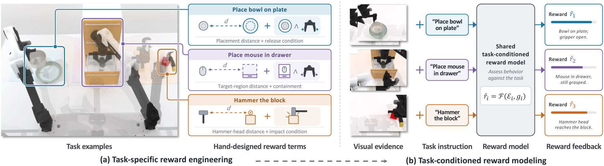
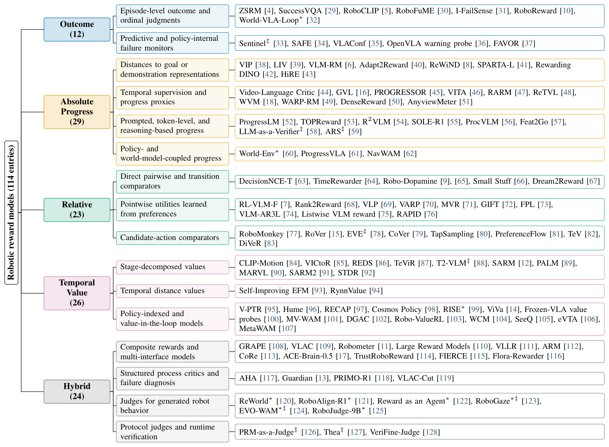
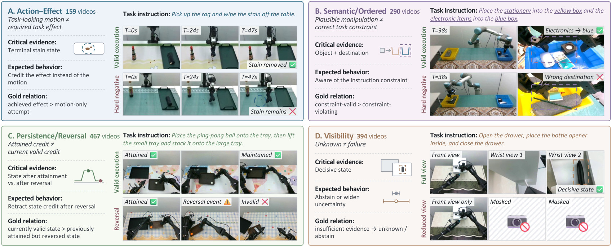

<div align="center">
<br>

# Awesome Robot Reward Models:<br>A Survey and Capability Benchmark

<a href="https://ethanliang99.github.io/">Guoqiang Liang</a><sup>&ast;</sup> &middot;
<a href="https://linyq17.github.io/">Yiqi Lin</a><sup>&ast;</sup> &middot;
<a href="https://shangchenzhou.com/">Shangchen Zhou</a> &middot;
<a href="https://wenzhengzeng.github.io/">Wenzheng Zeng</a> &middot;
<a href="https://chenanno.github.io/">Yanzhe Chen</a> &middot;
<a href="https://www.baizechen.site/">Zechen Bai</a> &middot;
<a href="https://sites.google.com/view/showlab/home">Mike Zheng Shou</a><sup>&dagger;</sup>

<a href="https://sites.google.com/view/showlab/home">Show Lab @ National University of Singapore</a> &middot; Nanyang Technological University<br>
<sub><sup>&ast;</sup>Equal contribution &nbsp; <sup>&dagger;</sup>Corresponding author</sub>

<p align="center">
  📄 Paper (coming soon) &nbsp; | &nbsp;
  <a href="https://ethanliang99.github.io/awesome-robot-reward-model/">🌐 Project Website</a> &nbsp; | &nbsp;
  🧰 RewardBox (coming soon) &nbsp; | &nbsp;
  🤗 RRM-Bench-1K (coming soon)
</p>

</div>

---

This repository accompanies our survey **Robotic Reward Models in the Foundation-Model Era: A Survey and Capability Benchmark**. A robotic reward model (RRM) is a task-conditioned evaluator that uses a foundation model to judge robot behavior against a task. The survey asks one question: ***under the one word "reward", what is each model actually answering?***

<p align="center">
  <a href="./assets/readme/teaser.png">
    
  </a>
</p>

<p align="center"><sub>From per-task reward engineering (a) to one task-conditioned evaluator shared across tasks (b).</sub></p>

- 🔎 **One word, five questions.** We organize 114 methods into five semantic families by the question their native output answers: Outcome, Absolute Progress, Relative, Temporal Value, and Hybrid.
- 🧪 **A benchmark of the hard cases.** RRM-Bench-1K holds 1,117 real-robot videos with task-state and camera-evidence labels, in four contrast suites that separate the credited condition from its usual cues.
- 📉 **What one score hides.** Across 27 evaluators, the strongest final scores rank whole executions well, yet dense credit follows the progression of an execution more closely than its task state, and no evaluator signals when the decisive view is missing.

> [!IMPORTANT]
> **This area is growing quickly, and so is this list.** If we missed a paper, or you have just published one of your own, please open an issue or send a pull request. We are always glad to add new work!

## 🌳 Taxonomy

<p align="center">
  <a href="./assets/readme/taxonomy.png">
    
  </a>
</p>

<p align="center"><sub>114 methods by semantic family and design route. * evaluates generated behavior; ‡ is a protocol or harness.</sub></p>

| Family | Question it answers | Typical native output | Methods |
|---|---|---|---|
| [Outcome](#outcome) | Is the task done, or will it fail? | success probability, 1–5 grade, failure score | 12 |
| [Absolute Progress](#absolute-progress) | How far along is it? | progress in [0, 1], completion percentage | 29 |
| [Relative](#relative) | Which is better? | pairwise preference, signed change between two states | 23 |
| [Temporal Value](#temporal-value) | Which stage, and how well is it going? | stage progress, seconds to completion, V and Q values | 26 |
| [Hybrid](#hybrid) | What happened, and on what evidence? | progress with success and preference, a verdict with its cause | 24 |

## 📢 News

- [x] `2026.11` First release: 114 methods in five families, with benchmarks and data resources.
- [ ] Survey paper on arXiv, the RewardBox toolbox, and the RRM-Bench-1K data: coming soon.

## 📑 Contents

- [Taxonomy](#-taxonomy) · [News](#-news)
- [A. Related Surveys](#-a-related-surveys)
- [B. Robotic Reward Models](#-b-robotic-reward-models)
  - [Outcome](#outcome) · [Absolute Progress](#absolute-progress) · [Relative](#relative) · [Temporal Value](#temporal-value) · [Hybrid](#hybrid)
- [C. Benchmarks](#-c-benchmarks)
- [D. Data](#-d-data)
- [Contributing](#-contributing) · [Acknowledgements](#-acknowledgements) · [License](#%EF%B8%8F-license) · [Citation](#-citation)

---

## 📚 A. Related Surveys

- **Progress Reward Modeling for Robotic Learning: A Comprehensive Survey**  
  [](https://arxiv.org/abs/2607.21655)

- **No Free Checker: A Survey of Verifiers for Robot Policies**  
  [](https://arxiv.org/abs/2609.09250)

- **Position: Good Embodied Reward Models Need Bad Behavior Data**  
  [](https://arxiv.org/abs/2606.01036)

- **Intrinsic Robot Rewarding**  
  [](https://arxiv.org/abs/2609.17115)

Related lists: [Awesome Progress Reward Model](https://github.com/VanceChu/Awesome-Progress-Reward-Model) · [Awesome Robot Failure Management](https://robot-failures.github.io/awesome-robot-failure-management/datasets.html) · [RewardScope](https://github.com/philfung/reward-scope)

## 🤖 B. Robotic Reward Models

Methods are grouped by semantic family and design route, in order of first release. The native output is what a model returns before any downstream transformation.  marks the 14 methods that the survey benchmarks and the RewardBox toolbox runs. \* evaluates generated behavior; ‡ is a protocol or harness.

### Outcome

[](#-taxonomy) ***Is the task done, or will it fail?*** Judges whether a declared event has occurred or will occur: terminal success, an end-of-episode grade, or a failure forecast.

#### Episode-level outcome and ordinal judgments

- **ZSRM**: Zero-Shot Reward Specification via Grounded Natural Language `2022.07`  
  [](https://proceedings.mlr.press/v162/mahmoudieh22a.html) <sub>Native output: binary goal condition</sub>

- **SuccessVQA**: Vision-Language Models as Success Detectors `2023.03`  
  [](https://arxiv.org/abs/2303.07280) <sub>Native output: binary success answer</sub>

- **RoboCLIP**: One Demonstration is Enough to Learn Robot Policies `2023.10`  
  [](https://papers.nips.cc/paper_files/paper/2023/hash/ae54ce310476218f26dd48c1626d5187-Abstract-Conference.html) [](https://github.com/sumedh7/RoboCLIP) <sub>Native output: episode compatibility</sub>

- **RoboFuME**: Robot Fine-Tuning Made Easy: Pre-Training Rewards and Policies for Autonomous Real-World Reinforcement Learning `2023.10`  
  [](https://arxiv.org/abs/2310.15145) <sub>Native output: binary completion</sub>

- **I-FailSense**: Towards General Robotic Failure Detection with Vision-Language Models `2025.09`  
  [](https://arxiv.org/abs/2509.16072) [](https://github.com/clemgris/I-FailSense) [](https://huggingface.co/collections/ACIDE/failsense-3b) [](https://clemgris.github.io/I-FailSense/) <sub>Native output: binary success/failure</sub>

- **RoboReward**: General-Purpose Vision-Language Reward Models for Robotics `2026.01`  
  [](https://arxiv.org/abs/2601.00675) [](https://huggingface.co/teetone/RoboReward-4B) [](https://huggingface.co/datasets/teetone/RoboReward)  <sub>Native output: end-episode progress (1–5)</sub>

- **World-VLA-Loop**\*: Closed-Loop Learning of Video World Model and VLA Policy `2026.02`  
  [](https://arxiv.org/abs/2602.06508) <sub>Native output: success score</sub>

#### Predictive and policy-internal failure monitors

- **Sentinel**‡: Unpacking Failure Modes of Generative Policies: Runtime Monitoring of Consistency and Progress `2024.10`  
  [](https://arxiv.org/abs/2410.04640) <sub>Native output: failure forecast + rationale</sub>

- **SAFE**: Multitask Failure Detection for Vision-Language-Action Models `2025.06`  
  [](https://arxiv.org/abs/2506.09937) <sub>Native output: running failure score</sub>

- **VLAConf**: Calibrated Task-Success Confidence for Vision-Language-Action Models `2026.05`  
  [](https://arxiv.org/abs/2605.29605) <sub>Native output: calibrated success confidence</sub>

- **OpenVLA warning probe**: Early Warning Signals for OpenVLA Failure under Visual Distribution Shift `2026.06`  
  [](https://arxiv.org/abs/2606.29699) <sub>Native output: failure probability</sub>

- **FAVOR**: Future Anchored Verification and Online Recovery for World Action Models `2026.10`  
  [](https://arxiv.org/abs/2610.06280) <sub>Native output: deviation-event probability</sub>

### Absolute Progress

[](#-taxonomy) ***How far along is it?*** Estimates advancement on a whole-task scale, anchored by a goal, a reference, a learned scale, or the task procedure.

#### Distances to goal or demonstration representations

- **VIP**: Towards Universal Visual Reward and Representation via Value-Implicit Pre-Training `2022.09`  
  [](https://openreview.net/forum?id=YJ7o2wetJ2) [](https://github.com/facebookresearch/vip) [](https://github.com/facebookresearch/vip#vip-usage-examples) <sub>Native output: goal distance</sub>

- **LIV**: Language-Image Representations and Rewards for Robotic Control `2023.06`  
  [](https://proceedings.mlr.press/v202/ma23b.html) [](https://github.com/penn-pal-lab/LIV) [](https://huggingface.co/jasonyma/LIV) [](https://github.com/penn-pal-lab/LIV/blob/main/liv/dataset/README.md) <sub>Native output: value</sub>

- **VLM-RM**: Vision-Language Models are Zero-Shot Reward Models for Reinforcement Learning `2023.10`  
  [](https://openreview.net/forum?id=N0I2RtD8je) [](https://github.com/AlignmentResearch/vlmrm) <sub>Native output: compatibility</sub>

- **Adapt2Reward**: Adapting Video-Language Models to Generalizable Robotic Rewards via Failure Prompts `2024.07`  
  [](https://doi.org/10.1007/978-3-031-72998-0_10) <sub>Native output: compatibility</sub>

- **ReWiND**: Language-Guided Rewards Teach Robot Policies without New Demonstrations `2025.05`  
  [](https://arxiv.org/abs/2505.10911) [](https://github.com/rewind-reward/ReWiND) <sub>Native output: progress</sub>

- **SPARTA-L**: Mash, Spread, Slice! Learning to Manipulate Object States via Visual Spatial Progress `2025.09`  
  [](https://arxiv.org/abs/2509.24129) <sub>Native output: object-state progress</sub>

- **Rewarding DINO**: Predicting Dense Rewards with Vision Foundation Models `2026.03`  
  [](https://arxiv.org/abs/2603.16978) <sub>Native output: reward</sub>

- **HiRE**: Hindsight Reward Editing for Policy Finetuning `2026.09`  
  [](https://arxiv.org/abs/2609.27068) <sub>Native output: success/failure support potential</sub>

#### Temporal supervision and progress proxies

- **Video-Language Critic**: Transferable Reward Functions for Language-Conditioned Robotics `2024.05`  
  [](https://openreview.net/forum?id=jJOVpnNrEp) [](https://github.com/minttusofia/video_language_critic) <sub>Native output: clip value</sub>

- **GVL**: Vision Language Models are In-Context Value Learners `2024.11`  
  [](https://openreview.net/forum?id=friHAl5ofG)  <sub>Native output: completion %</sub>

- **PROGRESSOR**: A Perceptually Guided Reward Estimator with Self-Supervised Online Refinement `2024.11`  
  [](https://doi.org/10.1109/ICCV51701.2025.00959) <sub>Native output: progress distribution</sub>

- **VITA**: Zero-Shot Value Functions via Test-Time Adaptation of Vision-Language Models `2025.06`  
  [](https://arxiv.org/abs/2506.10085) <sub>Native output: normalized progress</sub>

- **RARM**: Confidence-Gated Progress Reward Modeling for RL in Manipulation `2026.06`  
  [](https://arxiv.org/abs/2606.22027) <sub>Native output: confidence-gated progress</sub>

- **ReTVL**: Beyond Monotonic Progress: Retry-Supervised Value Learning for Robot Imitation `2026.06`  
  [](https://arxiv.org/abs/2606.24633) <sub>Native output: value</sub>

- **WVM**: World Value Models for Robotic Manipulation `2026.06`  
  [](https://arxiv.org/abs/2606.24742) <sub>Native output: progress sequence</sub>

- **WARP-RM**: A Warp-Augmented Relative Progress Reward Model for Data Curation `2026.06`  
  [](https://arxiv.org/abs/2606.28320) [](https://github.com/uynitsuj/WARP-RM) <sub>Native output: progress (+ velocity)</sub>

- **DenseReward**: Dense Reward Learning via Failure Synthesis for Robotic Manipulation `2026.07`  
  [](https://arxiv.org/abs/2607.13033) [](https://huggingface.co/densereward/densereward-3frame-thinking) [](https://huggingface.co/datasets/densereward/DenseReward) <sub>Native output: progress</sub>

- **AnyviewMeter**: Adapting Robotic Reward Models with Camera Geometry and Multi-View Attention `2026.09`  
  [](https://arxiv.org/abs/2609.20106) <sub>Native output: task progress</sub>

#### Prompted, token-level, and reasoning-based progress

- **ProgressLM**: Towards Progress Reasoning in Vision-Language Models `2026.01`  
  [](https://arxiv.org/abs/2601.15224) <sub>Native output: progress / unanswerable</sub>

- **TOPReward**: Token Probabilities as Hidden Zero-Shot Rewards for Robotics `2026.02`  
  [](https://arxiv.org/abs/2602.19313) [](https://github.com/TOPReward/TOPReward)  <sub>Native output: progress (log-prob)</sub>

- **R²VLM**: Recurrent Reasoning with Vision-Language Models for Estimating Long-Horizon Embodied Task Progress `2026.03`  
  [](https://arxiv.org/abs/2603.17312) <sub>Native output: completion % + rationale</sub>

- **SOLE-R1**: Video-Language Reasoning as the Sole Reward for On-Robot Reinforcement Learning `2026.03`  
  [](https://arxiv.org/abs/2603.28730) [](https://github.com/rai-opensource/sole-r1) [](https://huggingface.co/collections/theaiinstitute/sole-r1) [](https://huggingface.co/collections/theaiinstitute/sole-r1)  <sub>Native output: progress + rationale</sub>

- **ProcVLM**: Learning Procedure-Grounded Progress Rewards for Robotic Manipulation `2026.05`  
  [](https://arxiv.org/abs/2605.08774) [](https://github.com/ProcVLM/ProcVLM) [](https://huggingface.co/ce-amtic/ProcVLM-2B) [](https://huggingface.co/datasets/ce-amtic/ProcCorpus-60M)  <sub>Native output: progress + proc. rationale</sub>

- **Feat2Go**: Visual Feature-Grounded Value Estimation for Embodied Reinforcement Learning `2026.05`  
  [](https://arxiv.org/abs/2605.30795) <sub>Native output: binned structural progress</sub>

- **LLM-as-a-Verifier**‡: A General-Purpose Verification Framework `2026.07`  
  [](https://arxiv.org/abs/2607.05391) <sub>Native output: progress (score-token expectation)</sub>

- **ARS**‡: Agentic Reward System for Robot Learning `2026.09`  
  [](https://arxiv.org/abs/2609.34484) <sub>Native output: per-frame progress</sub>

#### Policy- and world-model-coupled progress

- **World-Env**\*: RehearseVLA: Simulated Post-Training for VLAs with Physically-Consistent World Model `2025.09`  
  [](https://arxiv.org/abs/2509.24948) [](https://github.com/amap-cvlab/world-env) [](https://www.modelscope.cn/models/junjxiao/world-env) <sub>Native output: completion probability</sub>

- **ProgressVLA**: Progress-Guided Diffusion Policy for Vision-Language Robotic Manipulation `2026.03`  
  [](https://arxiv.org/abs/2603.27670) <sub>Native output: progress</sub>

- **NavWAM**: A Navigation World Action Model for Goal-Conditioned Visual Navigation `2026.06`  
  [](https://arxiv.org/abs/2606.13494) <sub>Native output: progress value</sub>

### Relative

[](#-taxonomy) ***Which is better?*** Orders executions, states, or actions, from a direct comparison of a pair to a utility learned from preferences.

#### Direct pairwise and transition comparators

- **DecisionNCE-T**: DecisionNCE: Embodied Multimodal Representations via Implicit Preference Learning `2024.02`  
  [](https://arxiv.org/abs/2402.18137) <sub>Native output: transition-direction score</sub>

- **TimeRewarder**: Learning Dense Reward from Passive Videos via Frame-wise Temporal Distance `2025.09`  
  [](https://arxiv.org/abs/2509.26627) [](https://github.com/CowAndSheep/TimeRewarder) <sub>Native output: signed temporal distance</sub>

- **Robo-Dopamine**: General Process Reward Modeling for Robotic Reinforcement Learning `2025.12`  
  [](https://arxiv.org/abs/2512.23703) [](https://github.com/FlagOpen/Robo-Dopamine) [](https://huggingface.co/tanhuajie2001/Robo-Dopamine-GRM-8B) [](https://huggingface.co/datasets/tanhuajie2001/Robo-Dopamine-GRM-Dataset)  <sub>Native output: relative progress</sub>

- **Small Stuff**: Robot Critics that Sweat the Small Stuff `2026.06`  
  [](https://arxiv.org/abs/2606.21572) <sub>Native output: pairwise progress judgment</sub>

- **Dream2Reward**: Transition-Alignment Reward Models from Positive Demonstrations for Robotic Manipulation `2026.08`  
  [](https://arxiv.org/abs/2608.18787) <sub>Native output: signed transition alignment</sub>

#### Pointwise utilities learned from preferences

- **RL-VLM-F**: Reinforcement Learning from Vision Language Foundation Model Feedback `2024.02`  
  [](https://proceedings.mlr.press/v235/wang24bn.html) <sub>Native output: scalar task utility</sub>

- **Rank2Reward**: Learning Shaped Reward Functions from Passive Video `2024.04`  
  [](https://arxiv.org/abs/2404.14735) <sub>Native output: temporal-order utility</sub>

- **VLP**: Vision-Language Preference Learning for Embodied Manipulation `2025.02`  
  [](https://arxiv.org/abs/2502.11918) <sub>Native output: trajectory utility</sub>

- **VARP**: Reinforcement Learning from Vision-Language Model Feedback with Agent Regularized Preferences `2025.03`  
  [](https://arxiv.org/abs/2503.13817) <sub>Native output: preference utility</sub>

- **MVR**: Multi-view Video Reward Shaping for Reinforcement Learning `2026.03`  
  [](https://arxiv.org/abs/2603.01694) [](https://github.com/mvr-rl/mvr) <sub>Native output: state relevance utility</sub>

- **GIFT**: Generalizing Intent for Flexible Test-Time Rewards `2026.03`  
  [](https://arxiv.org/abs/2603.22574) <sub>Native output: intent-conditioned utility</sub>

- **FPL**: Freeform Preference Learning for Robotic Manipulation `2026.06`  
  [](https://arxiv.org/abs/2606.32027) [](https://github.com/freeform-pl/fpl) <sub>Native output: criterion-cond. utility</sub>

- **VLM-AR3L**: Vision-Language Models for Absolute and Relative Rewards in Reinforcement Learning `2026.07`  
  [](https://arxiv.org/abs/2607.00483) <sub>Native output: utility / pair preference</sub>

- **Listwise VLM reward**: Beyond Pairwise Feedback: Listwise Vision-Language Supervision for Preference-Based Reward Learning `2026.08`  
  [](https://arxiv.org/abs/2608.25350) <sub>Native output: preference utility</sub>

- **RAPID**: Scaling Vision-Language Reward Learning for Robot Manipulation in Parallel Simulation `2026.09`  
  [](https://arxiv.org/abs/2609.21767) <sub>Native output: preference utility</sub>

#### Candidate-action comparators

- **RoboMonkey**: Scaling Test-Time Sampling and Verification for Vision-Language-Action Models `2025.06`  
  [](https://arxiv.org/abs/2506.17811) [](https://github.com/robomonkey-vla/RoboMonkey) [](https://huggingface.co/robomonkey-vla/monkey-verifier-7b) [](https://huggingface.co/datasets/robomonkey-vla/action_preference_bridge) <sub>Native output: rank</sub>

- **RoVer**: Robot Reward Model as Test-Time Verifier for Vision-Language-Action Model `2025.10`  
  [](https://arxiv.org/abs/2510.10975) <sub>Native output: rank + direction</sub>

- **EVE**‡: A Generator-Verifier System for Generative Policies `2025.12`  
  [](https://arxiv.org/abs/2512.21430) <sub>Native output: candidate selection</sub>

- **CoVer**: Scaling Verification Can Be More Effective than Scaling Policy Learning for Vision-Language-Action Alignment `2026.02`  
  [](https://arxiv.org/abs/2602.12281) [](https://github.com/cover-vla/cover-vla) [](https://huggingface.co/cover-vla) <sub>Native output: alignment score</sub>

- **TapSampling**: Inference-Time Sampling with a Task-Progress-Understanding Verifier for Robotic Manipulation `2026.05`  
  [](https://arxiv.org/abs/2605.25547) [](https://github.com/aipixel/TapSampling) [](https://huggingface.co/collections/SizheZhao/tapsampling) [](https://huggingface.co/datasets/SizheZhao/TapSampling-CALVIN-Part-Data) <sub>Native output: progress delta</sub>

- **PreferenceFlow**: Test-Time Guidance of Flow-Matching Robot Policies from Human Interventions `2026.09`  
  [](https://arxiv.org/abs/2609.36872) <sub>Native output: action preference utility</sub>

- **TeV**: Looking Back to Move Forward: Temporal Verification for Generative Robot Policies `2026.09`  
  [](https://arxiv.org/abs/2609.39038) <sub>Native output: action energy</sub>

- **DiVeR**: Decision-Critical Verifier Learning for VLA Test-Time Scaling `2026.10`  
  [](https://arxiv.org/abs/2610.04933) <sub>Native output: candidate utility</sub>

### Temporal Value

[](#-taxonomy) ***Which stage, and how well is it going?*** Measures against a reference the execution itself sets: the stage reached, the time to go, or the return expected under the policy that continues it.

#### Stage-decomposed values

- **CLIP-Motion**: Learning Reward Functions for Robotic Actions Using Consecutive Observations `2023.11`  
  [](https://arxiv.org/abs/2311.03485) <sub>Native output: motion stage / stage reward</sub>

- **VICtoR**: Learning Hierarchical Vision-Instruction Correlation Rewards for Long-horizon Manipulation `2024.05`  
  [](https://arxiv.org/abs/2405.16545) <sub>Native output: stage-aware motion progress</sub>

- **REDS**: Subtask-Aware Visual Reward Learning from Segmented Demonstrations `2025.02`  
  [](https://arxiv.org/abs/2502.20630) <sub>Native output: subtask-conditioned reward</sub>

- **TeViR**: Text-to-Video Reward with Diffusion Models for Efficient Reinforcement Learning `2025.05`  
  [](https://arxiv.org/abs/2505.19769) <sub>Native output: reached-reference stage</sub>

- **T2-VLM**‡: Training-free Generation of Temporally Consistent Rewards from VLMs `2025.07`  
  [](https://arxiv.org/abs/2507.04789) <sub>Native output: tracked subgoal reward</sub>

- **SARM**: Stage-Aware Reward Modeling for Long Horizon Robot Manipulation `2025.09`  
  [](https://arxiv.org/abs/2509.25358) [](https://github.com/xdofai/opensarm) <sub>Native output: stage + progress</sub>

- **PALM**: Progress-Aware Policy Learning via Affordance Reasoning for Long-Horizon Robotic Manipulation `2026.01`  
  [](https://arxiv.org/abs/2601.07060) [](https://github.com/PLAN-Lab/PALM) [](https://github.com/PLAN-Lab/PALM#-checkpoints) <sub>Native output: progress</sub>

- **MARVL**: Multi-Stage Guidance for Robotic Manipulation via Vision-Language Models `2026.01`  
  [](https://arxiv.org/abs/2602.15872) <sub>Native output: staged similarity</sub>

- **SARM2**: Multi-Task Stage Aware Reward Modeling for Self Improving Robotic Manipulation `2026.06`  
  [](https://arxiv.org/abs/2606.10305) [](https://github.com/xdofai/opensarm) <sub>Native output: stage + value</sub>

- **STDR**: Stage-Transition Dense Reward Modeling for Reinforcement Learning `2026.06`  
  [](https://arxiv.org/abs/2606.31377) <sub>Native output: stage + within-stage progress</sub>

#### Temporal distance values

- **Self-Improving EFM**: Self-Improving Embodied Foundation Models `2025.09`  
  [](https://arxiv.org/abs/2509.15155) <sub>Native output: steps-to-go distribution</sub>

- **RynnValue**: Scaling Robotic Value Foundation Models with Temporal Distance `2026.08`  
  [](https://arxiv.org/abs/2608.09853) [](https://github.com/alibaba-damo-academy/RynnValue) [](https://huggingface.co/Alibaba-DAMO-Academy/RynnValue-4B)  <sub>Native output: temporal distance (absolute + signed)</sub>

#### Policy-indexed and value-in-the-loop models

- **V-PTR**: Robotic Offline RL from Internet Videos via Value-Function Learning `2023.09`  
  [](https://arxiv.org/abs/2309.13041) <sub>Native output: task Q-value</sub>

- **Hume**: Introducing System-2 Thinking in Visual-Language-Action Model `2025.05`  
  [](https://arxiv.org/abs/2505.21432) [](https://github.com/hume-vla/hume) [](https://huggingface.co/Hume-vla/Hume-System2) <sub>Native output: Q-value</sub>

- **RECAP**: (^*_0.6): A VLA That Learns From Experience `2025.11`  
  [](https://arxiv.org/abs/2511.14759) <sub>Native output: return distribution (steps to success)</sub>

- **Cosmos Policy**: Fine-Tuning Video Models for Visuomotor Control and Planning `2026.01`  
  [](https://arxiv.org/abs/2601.16163) [](https://github.com/NVlabs/cosmos-policy) [](https://huggingface.co/collections/nvidia/cosmos-policy) [](https://huggingface.co/collections/nvidia/cosmos-policy) <sub>Native output: return value</sub>

- **RISE**\*: Self-Improving Robot Policy with Compositional World Model `2026.02`  
  [](https://arxiv.org/abs/2602.11075) [](https://github.com/OpenDriveLab/RISE) [](https://github.com/OpenDriveLab/RISE) <sub>Native output: progress/TD value</sub>

- **ViVa**: A Video-Generative Value Model for Robot Reinforcement Learning `2026.04`  
  [](https://arxiv.org/abs/2604.08168) [](https://github.com/GigaAI-research/ViVa) <sub>Native output: task value</sub>

- **Frozen-VLA value probes**: What Frozen VLAs Already Know About Success: A Probing Study of Value-Like Structure in Foundation Robot Policies `2026.05`  
  [](https://arxiv.org/abs/2605.28527) <sub>Native output: discounted outcome</sub>

- **MV-WAM**: Manifold-Aware World Action Model with Value Augmentation `2026.06`  
  [](https://arxiv.org/abs/2606.21088) <sub>Native output: return value</sub>

- **DGAC**: Robot Self-Improvement via Human-Video Dynamics Models `2026.06`  
  [](https://arxiv.org/abs/2606.21406) <sub>Native output: value / candidate rank</sub>

- **Robo-ValueRL**: Reliable Value Estimation for Offline-to-Online Reinforcement Learning `2026.07`  
  [](https://arxiv.org/abs/2607.09866) [](https://github.com/Open-X-Humanoid/Robo-ValueRL) [](https://huggingface.co/X-Humanoid/Robo-ValueRL) [](https://huggingface.co/datasets/X-Humanoid/Robo-ValueRL)  <sub>Native output: normalized time-to-go value</sub>

- **WCM**: A World Critic Model for Vision-Language-Action Reinforcement Learning `2026.07`  
  [](https://arxiv.org/abs/2607.29613) [](https://github.com/sylvestf/WCM) <sub>Native output: history value</sub>

- **SeeQ**: Training Generalist Value Functions for Long-Horizon Robotic Manipulation `2026.09`  
  [](https://arxiv.org/abs/2609.22085) [](https://huggingface.co/CMU-AIRe/SeeQ-3B) <sub>Native output: subtask Q-value</sub>

- **eVTA**: Demonstration-Free Success-Probability Reward Learning for Generalist Robot Policies `2026.09`  
  [](https://arxiv.org/abs/2609.33653) <sub>Native output: expected future success</sub>

- **MetaWAM**: From Video Frames to Robot Meta-Frames: A Unified Latent Interface for World Action Models `2026.11`  
  [](https://arxiv.org/abs/2611.14365) <sub>Native output: return value</sub>

### Hybrid

[](#-taxonomy) ***What happened, and on what evidence?*** Composes several judgments, from different families or as the fields of a structured verification judgment.

#### Composite rewards and multi-interface models

- **GRAPE**: Generalizing Robot Policy via Preference Alignment `2024.11`  
  [](https://arxiv.org/abs/2411.19309) <sub>Native output: stage cost + self-likelihood + success</sub>

- **VLAC**: A Vision-Language-Action-Critic Model for Robotic Real-World Reinforcement Learning `2025.09`  
  [](https://arxiv.org/abs/2509.15937) [](https://github.com/InternRobotics/VLAC)  <sub>Native output: relative progress + done</sub>

- **Robometer**: Scaling General-Purpose Robotic Reward Models via Trajectory Comparisons `2026.03`  
  [](https://arxiv.org/abs/2603.02115) [](https://github.com/robometer/robometer) [](https://huggingface.co/robometer/Robometer-4B)  <sub>Native output: progress + success + pref.</sub>

- **Large Reward Models**: Generalizable Online Robot Reward Generation with Vision-Language Models `2026.03`  
  [](https://arxiv.org/abs/2603.16065) [](https://github.com/physical-superintelligence-lab/Large-Reward-Models)  <sub>Native output: multi-part reward</sub>

- **VLLR**: Generalizable Dense Reward for Long-Horizon Robotic Tasks `2026.03`  
  [](https://arxiv.org/abs/2604.00055) <sub>Native output: subgoal progress (critic init.) + self-certainty + outcome</sub>

- **ARM**: Advantage Reward Modeling for Long-Horizon Manipulation `2026.04`  
  [](https://arxiv.org/abs/2604.03037) <sub>Native output: advantage + completion</sub>

- **CoRe**: Combined Rewards with Vision-Language Model Feedback for Preference-Aligned Reinforcement Learning `2026.07`  
  [](https://arxiv.org/abs/2607.01721) <sub>Native output: formal + residual reward</sub>

- **ACE-Brain-0.5**: A Unified Embodied Foundational Model for Physical Agentic AI `2026.07`  
  [](https://arxiv.org/abs/2607.04426) [](https://huggingface.co/ACERobotics/ACE-Brain-0.5-8B) <sub>Native output: progress + preference</sub>

- **TrustRoboReward**: Preference-Ordered Isotonic Score Editing for Multi-Paradigm Robot Reward Models `2026.08`  
  [](https://arxiv.org/abs/2608.08491) <sub>Native output: scores / comparisons + rationale</sub>

- **FIERCE**: From Generalist Robot Policies to Fast Specialists via Progress-Failure Feedback `2026.09`  
  [](https://arxiv.org/abs/2609.18651) <sub>Native output: progress + future failure risk</sub>

- **Flora-Rewarder**: FLORA: An Open Model Suite for Scaling Robotics Data Engines `2026.10`  
  [](https://arxiv.org/abs/2610.31779) [](https://github.com/NVlabs/Flora) [](https://huggingface.co/nvidia/Flora-Rewarder)  <sub>Native output: episode grade (1–5) + step action quality + rubric scores</sub>

#### Structured process critics and failure diagnosis

- **AHA**: A Vision-Language-Model for Detecting and Reasoning Over Failures in Robotic Manipulation `2024.10`  
  [](https://openreview.net/forum?id=JVkdSi7Ekg) <sub>Native output: sub-task verdict + failure explanation</sub>

- **Guardian**: Detecting Robotic Planning and Execution Errors with Vision-Language Models `2025.12`  
  [](https://arxiv.org/abs/2512.01946) [](https://github.com/paulpacaud/Guardian-FailCot) [](https://huggingface.co/paulpacaud/guardian-thinking) [](https://huggingface.co/collections/paulpacaud/robotic-failure-detection-dataset-and-model-guardian) <sub>Native output: verdict + reasoning trace</sub>

- **PRIMO-R1**: From Passive Observer to Active Critic: Reinforcement Learning Elicits Process Reasoning for Robotic Manipulation `2026.03`  
  [](https://arxiv.org/abs/2603.15600)  <sub>Native output: progress + failure + CoT</sub>

- **VLAC-Cut**: HELP: Human-Efficient Large-Scale Robot Post-Training with Rollout Segmentation `2026.07`  
  [](https://arxiv.org/abs/2607.09776) [](https://github.com/InternRobotics/VLAC-cut) [](https://huggingface.co/InternRobotics/VLAC-Cut) [](https://huggingface.co/datasets/InternRobotics/VLAC-Cut-FullData)  <sub>Native output: signed progress + diagnosis + cut points</sub>

#### Judges for generated robot behavior

- **ReWorld**\*: Multi-Dimensional Reward Modeling for Embodied World Models `2026.01`  
  [](https://arxiv.org/abs/2601.12428) <sub>Native output: hierarchical four aspects</sub>

- **RoboAlign-R1**\*: Distilled Multimodal Reward Alignment for Robot Video World Models `2026.05`  
  [](https://arxiv.org/abs/2605.03821) <sub>Native output: six scores</sub>

- **Reward as an Agent**\*: Reward as An Agent for Embodied World Models `2026.06`  
  [](https://arxiv.org/abs/2606.19990) [](https://github.com/SpursLipu/Reward-as-An-Agent-for-Embodied-World-Models) <sub>Native output: 4-aspect scores + rationale</sub>

- **RoboGaze**\*‡: Evaluating Robot World Models via Structured Vision-Language Analysis `2026.06`  
  [](https://arxiv.org/abs/2606.28385) <sub>Native output: localized failure events + severity</sub>

- **EVO-WAM**\*‡: Evolving World Action Models through Video-Action Verification `2026.09`  
  [](https://arxiv.org/abs/2609.38057) <sub>Native output: completion + action consistency</sub>

- **RoboJudge-9B**\*: RoboJudge: Multimodal Language Models as Judges for Embodied Video Generation `2026.10`  
  [](https://arxiv.org/abs/2610.27782) <sub>Native output: physical adherence + instruction alignment + rationale</sub>

#### Protocol judges and runtime verification

- **PRM-as-a-Judge**‡: A Dense Evaluation Paradigm for Fine-Grained Robotic Auditing `2026.03`  
  [](https://arxiv.org/abs/2603.21669) [](https://github.com/Yuheng2000/PRM-as-a-Judge) [](https://huggingface.co/datasets/yuheng2000/RoboPulse) <sub>Native output: outcome–process–diagnosis profile</sub>

- **Thea**‡: Towards the Harness of Embodied Agents `2026.08`  
  [](https://arxiv.org/abs/2608.11246) [](https://github.com/EIT-HAI/Thea) <sub>Native output: status + evidence + cause</sub>

- **VeriFine-Judge**: VeriFine: Scaling Verification for Self-Improvement in Embodied Reasoning `2026.10`  
  [](https://arxiv.org/abs/2610.08761) <sub>Native output: rubric scores + diagnostics</sub>

Related evaluators outside the survey's corpus: [GORDON](https://arxiv.org/abs/2608.03753) · [ProgAgent](https://arxiv.org/abs/2603.07784) · [EVOLVE-VLA](https://arxiv.org/abs/2512.14666) · [ProgVLA](https://arxiv.org/abs/2605.28231) · [Diffusion Reward](https://arxiv.org/abs/2312.14134) · [VLA-Corrector](https://arxiv.org/abs/2609.06508) · [Success Visitation Matching](https://arxiv.org/abs/2606.23640)

## 🧪 C. Benchmarks

**RRM-Bench-1K** (ours) tests whether a reward follows the task state of a real execution rather than motion, elapsed time, or what the camera happens to show. Its four contrast suites each separate the credited condition from a cue that usually comes with it.

<p align="center">
  <a href="./assets/readme/suites.jpg">
    
  </a>
</p>

| Benchmark | Measures | Scale |
|---|---|---|
| [**RRM-Bench-1K**](https://ethanliang99.github.io/awesome-robot-reward-model/#bench) (ours) | Whether credit follows the task state: fulfillment, credit withdrawal, and camera evidence | 1,117 real-robot videos |
| [ManiRewardBench](https://arxiv.org/abs/2602.19313) | Stage progress; success detection | 653 episodes; 130 tasks |
| [RBM-EVAL](https://arxiv.org/abs/2603.02115) | Progress alignment; ranking | 571 OOD videos |
| [PRIMO Bench](https://arxiv.org/abs/2603.15600) | Progress under task and scene shift | 18k samples; humanoid set |
| [RoboRewardBench](https://arxiv.org/abs/2601.00675) | Episode-end progress grade (1–5) | 2,831 test items |
| [RoboRMBench](https://arxiv.org/abs/2609.05401) | Paraphrase invariance of rewards | 2,390 trajectories |
| [Progress-Bench](https://arxiv.org/abs/2601.15224) | Progress from a demo; answerability | > 3k instances |
| [OpenGVL](https://arxiv.org/abs/2509.17321) | Temporal order of shuffled frames | 200 trajectories; 4 datasets |
| [RoboPulse](https://arxiv.org/abs/2603.21669) | Pairwise progress discrimination | 1,800 pairs; 816 tasks |
| [Suboptimal-Value-Bench](https://arxiv.org/abs/2606.24742) | Value under hesitation and retry | 800 trajectories; 15 tasks |
| [RoboPulse++](https://arxiv.org/abs/2608.14284) | Interval-level progress direction | 2,244 intervals |
| [FailBench](https://arxiv.org/abs/2609.03611) | Binary success detection | 2,197 attempts; 14 sources |
| [RoboValue](https://arxiv.org/abs/2610.26663) | Grounding, progress, recovery, and subtask credit | 2,792 test trajectories; 15 sim + 20 real tasks |

## 🗂️ D. Data

**Reward corpora released with a model**
- [RBM-1M](https://arxiv.org/abs/2603.02115) (Robometer): more than one million trajectories with progress, success, and preference labels.
- [Robo-Dopamine GRM data](https://huggingface.co/datasets/tanhuajie2001/Robo-Dopamine-GRM-Dataset): multiview state pairs built from annotated keyframes.
- [DenseReward corpus](https://huggingface.co/datasets/densereward/DenseReward): simulated episodes with failures and recoveries.

**Robot failure and recovery data**
- [RoboMIND](https://arxiv.org/abs/2412.13877): real teleoperation failures annotated with their causes.
- [RoboFAC](https://arxiv.org/abs/2505.12224), [FailSafe](https://arxiv.org/abs/2510.01642), [AHA](https://arxiv.org/abs/2410.00371): failures generated in simulation, with failure reasoning or corrections.
- [Guardian / FailCoT](https://arxiv.org/abs/2512.01946): planning and execution failures with reasoning traces, in simulation and on a real UR5.
- [ViFailback](https://arxiv.org/abs/2512.02787): real manipulation failures with correction guidance.
- [Dream2Fix](https://arxiv.org/abs/2603.13528): failures generated by a world model from real demonstrations.
- [SO-101 deployment study](https://arxiv.org/abs/2606.08881): naturally occurring failures on a low-cost arm.
- [EgoRecovery](https://arxiv.org/abs/2607.19745): human recovery behavior from an egocentric view.

**Real-robot evaluation platforms**
- [RoboChallenge Table30 and Table30 V2](https://robochallenge.ai/): learned policies scored by a rubric on standardized tasks; the source of RRM-Bench-1K.
- [RoboArena](https://arxiv.org/abs/2506.18123): double-blind pairwise comparisons of policies on the DROID setup.
- [REASSEMBLE](https://researchdata.tuwien.ac.at/records/0ewrv-8cb44), [RH20T](https://rh20t.github.io/): real demonstrations with success or quality labels.

**Human and egocentric video with error or outcome labels**
- [HRDexDB](https://snuvclab.github.io/HRDexDB/) · [IndEgo](https://indego-dataset.github.io/) · [EgoPER](https://khoury.northeastern.edu/home/eelhami/egoper.htm) · [CaptainCook4D](https://captaincook4d.github.io/captain-cook/) · [HoloAssist](https://holoassist.github.io/) · [Assembly101](https://assembly-101.github.io/)

## 🤝 Contributing

Contributions are very welcome: new papers, corrections, better categorization, or dead-link fixes.

1. Read [CONTRIBUTING.md](./CONTRIBUTING.md) for the entry format and placement rules.
2. Edit this README and submit a pull request against `main`. Include the first public release date, the native output, and your family choice when adding a paper.

## 🙏 Acknowledgements

We thank the researchers who make their papers, code, models, and datasets publicly available, and the maintainers of the related collections that help the community navigate this fast-moving field.

## ⚖️ License

The list is released under [CC0-1.0](./LICENSE). The listed papers remain under their own licenses and copyright. On the project page, the fonts keep their SIL Open Font License, and the robot videos, which record RoboChallenge executions, keep their own terms.

## 📝 Citation

If you find our repository useful, please cite:

```bibtex
@article{liang2026rrm,
  title   = {Robotic Reward Models in the Foundation-Model Era: A Survey and Capability Benchmark},
  author  = {Liang, Guoqiang and Lin, Yiqi and Zhou, Shangchen and Zeng, Wenzheng and Chen, Yanzhe and Bai, Zechen and Shou, Mike Zheng},
  year    = {2026},
  note    = {Project page: https://ethanliang99.github.io/awesome-robot-reward-model}
}
```

If you like the repository, please give us a star ⭐
