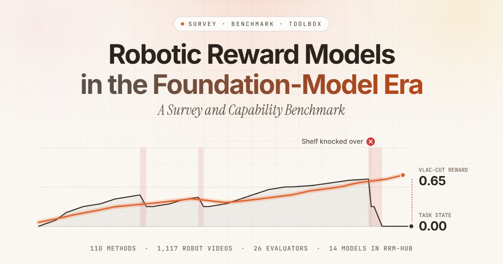

# Awesome Robot Reward Models

A curated list of robotic reward models, organized by the five semantic families of the survey **Robotic Reward Models in the Foundation-Model Era: A Survey and Capability Benchmark**.

[Project page](https://ethanliang99.github.io/awesome-robot-reward-model/) · Paper on arXiv (coming soon) · RewardBox toolbox and RRM-Bench-1K data (release pending)

[](https://ethanliang99.github.io/awesome-robot-reward-model/)

## What is a robotic reward model?

A robotic reward model (RRM) is a task-conditioned evaluator that uses a foundation model to judge robot behavior against a task. Under the one word *reward*, these models return success probabilities, completion percentages, preferences, expected returns, and diagnoses. Each answers a different question, so this list groups methods by the question their native output answers.

| Family | Question it answers | Typical native output | Methods |
|---|---|---|---|
| [Outcome](#outcome) | Is the task done, or will it fail? | success probability, 1–5 grade, failure score | 12 |
| [Absolute Progress](#absolute-progress) | How far along is it? | progress in [0, 1], completion percentage | 29 |
| [Relative](#relative) | Which is better? | pairwise preference, signed change between two states | 23 |
| [Temporal Value](#temporal-value) | Which stage, and how well is it going? | stage progress, seconds to completion, V and Q values | 26 |
| [Hybrid](#hybrid) | What happened, and on what evidence? | progress with success and preference, a verdict with its cause | 24 |

## Contents

- [Methods](#methods): 114 methods in five families
- [Benchmarks](#benchmarks)
- [Data](#data)
- [Related surveys and lists](#related-surveys-and-lists)
- [In this repository](#in-this-repository)
- [Citation](#citation)

## Methods

Within each family, methods are grouped by design route and ordered by first release. The native output is what a model returns before any downstream transformation.

- Methods in **bold** are benchmarked in the survey and run in RewardBox.
- \* evaluates generated behavior. ‡ is a protocol or harness.

### Outcome

*Is the task done, or will it fail?* Judges whether a declared event has occurred or will occur: terminal success, an end-of-episode grade, or a failure forecast.

**Episode-level outcome and ordinal judgments**

| Method | Year | Native output | Links |
|---|---|---|---|
| ZSRM | 2022 | Binary goal condition | [paper](https://proceedings.mlr.press/v162/mahmoudieh22a.html) |
| SuccessVQA | 2023 | Binary success answer | [paper](https://arxiv.org/abs/2303.07280) |
| RoboCLIP | 2023 | Episode compatibility | [paper](https://papers.nips.cc/paper_files/paper/2023/hash/ae54ce310476218f26dd48c1626d5187-Abstract-Conference.html) · [code](https://github.com/sumedh7/RoboCLIP) |
| RoboFuME | 2023 | Binary completion | [paper](https://arxiv.org/abs/2310.15145) |
| I-FailSense | 2025 | Binary success/failure | [paper](https://arxiv.org/abs/2509.16072) · [code](https://github.com/clemgris/I-FailSense) · [weights](https://huggingface.co/collections/ACIDE/failsense-3b) · [data](https://clemgris.github.io/I-FailSense/) |
| **RoboReward** | 2026 | End-episode progress (1–5) | [paper](https://arxiv.org/abs/2601.00675) · [weights](https://huggingface.co/teetone/RoboReward-4B) · [data](https://huggingface.co/datasets/teetone/RoboReward) |
| World-VLA-Loop* | 2026 | Success score | [paper](https://arxiv.org/abs/2602.06508) |

**Predictive and policy-internal failure monitors**

| Method | Year | Native output | Links |
|---|---|---|---|
| Sentinel‡ | 2024 | Failure forecast + rationale | [paper](https://arxiv.org/abs/2410.04640) |
| SAFE | 2025 | Running failure score | [paper](https://arxiv.org/abs/2506.09937) |
| VLAConf | 2026 | Calibrated success confidence | [paper](https://arxiv.org/abs/2605.29605) |
| OpenVLA warning probe | 2026 | Failure probability | [paper](https://arxiv.org/abs/2606.29699) |
| FAVOR | 2026 | Deviation-event probability | [paper](https://arxiv.org/abs/2610.06280) |

### Absolute Progress

*How far along is it?* Estimates advancement on a whole-task scale, anchored by a goal, a reference, a learned scale, or the task procedure.

**Distances to goal or demonstration representations**

| Method | Year | Native output | Links |
|---|---|---|---|
| VIP | 2022 | Goal distance | [paper](https://openreview.net/forum?id=YJ7o2wetJ2) · [code](https://github.com/facebookresearch/vip) · [weights](https://github.com/facebookresearch/vip#vip-usage-examples) |
| LIV | 2023 | Value | [paper](https://proceedings.mlr.press/v202/ma23b.html) · [code](https://github.com/penn-pal-lab/LIV) · [weights](https://huggingface.co/jasonyma/LIV) · [data](https://github.com/penn-pal-lab/LIV/blob/main/liv/dataset/README.md) |
| VLM-RM | 2023 | Compatibility | [paper](https://openreview.net/forum?id=N0I2RtD8je) · [code](https://github.com/AlignmentResearch/vlmrm) |
| Adapt2Reward | 2024 | Compatibility | [paper](https://doi.org/10.1007/978-3-031-72998-0_10) |
| ReWiND | 2025 | Progress | [paper](https://arxiv.org/abs/2505.10911) · [code](https://github.com/rewind-reward/ReWiND) |
| SPARTA-L | 2025 | Object-state progress | [paper](https://arxiv.org/abs/2509.24129) |
| Rewarding DINO | 2026 | Reward | [paper](https://arxiv.org/abs/2603.16978) |
| HiRE | 2026 | Success/failure support potential | [paper](https://arxiv.org/abs/2609.27068) |

**Temporal supervision and progress proxies**

| Method | Year | Native output | Links |
|---|---|---|---|
| Video-Language Critic | 2024 | Clip value | [paper](https://openreview.net/forum?id=jJOVpnNrEp) · [code](https://github.com/minttusofia/video_language_critic) |
| **GVL** | 2024 | Completion % | [paper](https://openreview.net/forum?id=friHAl5ofG) |
| PROGRESSOR | 2024 | Progress distribution | [paper](https://doi.org/10.1109/ICCV51701.2025.00959) |
| VITA | 2025 | Normalized progress | [paper](https://arxiv.org/abs/2506.10085) |
| RARM | 2026 | Confidence-gated progress | [paper](https://arxiv.org/abs/2606.22027) |
| ReTVL | 2026 | Value | [paper](https://arxiv.org/abs/2606.24633) |
| WVM | 2026 | Progress sequence | [paper](https://arxiv.org/abs/2606.24742) |
| WARP-RM | 2026 | Progress (+ velocity) | [paper](https://arxiv.org/abs/2606.28320) · [code](https://github.com/uynitsuj/WARP-RM) |
| DenseReward | 2026 | Progress | [paper](https://arxiv.org/abs/2607.13033) · [weights](https://huggingface.co/densereward/densereward-3frame-thinking) · [data](https://huggingface.co/datasets/densereward/DenseReward) |
| AnyviewMeter | 2026 | Task progress | [paper](https://arxiv.org/abs/2609.20106) |

**Prompted, token-level, and reasoning-based progress**

| Method | Year | Native output | Links |
|---|---|---|---|
| ProgressLM | 2026 | Progress / unanswerable | [paper](https://arxiv.org/abs/2601.15224) |
| **TOPReward** | 2026 | Progress (log-prob) | [paper](https://arxiv.org/abs/2602.19313) · [code](https://github.com/TOPReward/TOPReward) |
| R²VLM | 2026 | Completion % + rationale | [paper](https://arxiv.org/abs/2603.17312) |
| **SOLE-R1** | 2026 | Progress + rationale | [paper](https://arxiv.org/abs/2603.28730) · [code](https://github.com/rai-opensource/sole-r1) · [weights](https://huggingface.co/collections/theaiinstitute/sole-r1) · [data](https://huggingface.co/collections/theaiinstitute/sole-r1) |
| **ProcVLM** | 2026 | Progress + proc. rationale | [paper](https://arxiv.org/abs/2605.08774) · [code](https://github.com/ProcVLM/ProcVLM) · [weights](https://huggingface.co/ce-amtic/ProcVLM-2B) · [data](https://huggingface.co/datasets/ce-amtic/ProcCorpus-60M) |
| Feat2Go | 2026 | Binned structural progress | [paper](https://arxiv.org/abs/2605.30795) |
| LLM-as-a-Verifier‡ | 2026 | Progress (score-token expectation) | [paper](https://arxiv.org/abs/2607.05391) |
| ARS‡ | 2026 | Per-frame progress | [paper](https://arxiv.org/abs/2609.34484) |

**Policy- and world-model-coupled progress**

| Method | Year | Native output | Links |
|---|---|---|---|
| World-Env* | 2025 | Completion probability | [paper](https://arxiv.org/abs/2509.24948) · [code](https://github.com/amap-cvlab/world-env) · [weights](https://www.modelscope.cn/models/junjxiao/world-env) |
| ProgressVLA | 2026 | Progress | [paper](https://arxiv.org/abs/2603.27670) |
| NavWAM | 2026 | Progress value | [paper](https://arxiv.org/abs/2606.13494) |

### Relative

*Which is better?* Orders executions, states, or actions, from a direct comparison of a pair to a utility learned from preferences.

**Direct pairwise and transition comparators**

| Method | Year | Native output | Links |
|---|---|---|---|
| DecisionNCE-T | 2024 | Transition-direction score | [paper](https://arxiv.org/abs/2402.18137) |
| TimeRewarder | 2025 | Signed temporal distance | [paper](https://arxiv.org/abs/2509.26627) · [code](https://github.com/CowAndSheep/TimeRewarder) |
| **Robo-Dopamine** | 2025 | Relative progress | [paper](https://arxiv.org/abs/2512.23703) · [code](https://github.com/FlagOpen/Robo-Dopamine) · [weights](https://huggingface.co/tanhuajie2001/Robo-Dopamine-GRM-8B) · [data](https://huggingface.co/datasets/tanhuajie2001/Robo-Dopamine-GRM-Dataset) |
| Small Stuff | 2026 | Pairwise progress judgment | [paper](https://arxiv.org/abs/2606.21572) |
| Dream2Reward | 2026 | Signed transition alignment | [paper](https://arxiv.org/abs/2608.18787) |

**Pointwise utilities learned from preferences**

| Method | Year | Native output | Links |
|---|---|---|---|
| RL-VLM-F | 2024 | Scalar task utility | [paper](https://proceedings.mlr.press/v235/wang24bn.html) |
| Rank2Reward | 2024 | Temporal-order utility | [paper](https://arxiv.org/abs/2404.14735) |
| VLP | 2025 | Trajectory utility | [paper](https://arxiv.org/abs/2502.11918) |
| VARP | 2025 | Preference utility | [paper](https://arxiv.org/abs/2503.13817) |
| MVR | 2026 | State relevance utility | [paper](https://arxiv.org/abs/2603.01694) · [code](https://github.com/mvr-rl/mvr) |
| GIFT | 2026 | Intent-conditioned utility | [paper](https://arxiv.org/abs/2603.22574) |
| FPL | 2026 | Criterion-cond. utility | [paper](https://arxiv.org/abs/2606.32027) · [code](https://github.com/freeform-pl/fpl) |
| VLM-AR3L | 2026 | Utility / pair preference | [paper](https://arxiv.org/abs/2607.00483) |
| Listwise VLM reward | 2026 | Preference utility | [paper](https://arxiv.org/abs/2608.25350) |
| RAPID | 2026 | Preference utility | [paper](https://arxiv.org/abs/2609.21767) |

**Candidate-action comparators**

| Method | Year | Native output | Links |
|---|---|---|---|
| RoboMonkey | 2025 | Rank | [paper](https://arxiv.org/abs/2506.17811) · [code](https://github.com/robomonkey-vla/RoboMonkey) · [weights](https://huggingface.co/robomonkey-vla/monkey-verifier-7b) · [data](https://huggingface.co/datasets/robomonkey-vla/action_preference_bridge) |
| RoVer | 2025 | Rank + direction | [paper](https://arxiv.org/abs/2510.10975) |
| EVE‡ | 2025 | Candidate selection | [paper](https://arxiv.org/abs/2512.21430) |
| CoVer | 2026 | Alignment score | [paper](https://arxiv.org/abs/2602.12281) · [code](https://github.com/cover-vla/cover-vla) · [weights](https://huggingface.co/cover-vla) |
| TapSampling | 2026 | Progress delta | [paper](https://arxiv.org/abs/2605.25547) · [code](https://github.com/aipixel/TapSampling) · [weights](https://huggingface.co/collections/SizheZhao/tapsampling) · [data](https://huggingface.co/datasets/SizheZhao/TapSampling-CALVIN-Part-Data) |
| PreferenceFlow | 2026 | Action preference utility | [paper](https://arxiv.org/abs/2609.36872) |
| TeV | 2026 | Action energy | [paper](https://arxiv.org/abs/2609.39038) |
| DiVeR | 2026 | Candidate utility | [paper](https://arxiv.org/abs/2610.04933) |

### Temporal Value

*Which stage, and how well is it going?* Measures against a reference the execution itself sets: the stage reached, the time to go, or the return expected under the policy that continues it.

**Stage-decomposed values**

| Method | Year | Native output | Links |
|---|---|---|---|
| CLIP-Motion | 2023 | Motion stage / stage reward | [paper](https://arxiv.org/abs/2311.03485) |
| VICtoR | 2024 | Stage-aware motion progress | [paper](https://arxiv.org/abs/2405.16545) |
| REDS | 2025 | Subtask-conditioned reward | [paper](https://arxiv.org/abs/2502.20630) |
| TeViR | 2025 | Reached-reference stage | [paper](https://arxiv.org/abs/2505.19769) |
| T2-VLM‡ | 2025 | Tracked subgoal reward | [paper](https://arxiv.org/abs/2507.04789) |
| SARM | 2025 | Stage + progress | [paper](https://arxiv.org/abs/2509.25358) · [code](https://github.com/xdofai/opensarm) |
| PALM | 2026 | Progress | [paper](https://arxiv.org/abs/2601.07060) · [code](https://github.com/PLAN-Lab/PALM) · [weights](https://github.com/PLAN-Lab/PALM#-checkpoints) |
| MARVL | 2026 | Staged similarity | [paper](https://arxiv.org/abs/2602.15872) |
| SARM2 | 2026 | Stage + value | [paper](https://arxiv.org/abs/2606.10305) · [code](https://github.com/xdofai/opensarm) |
| STDR | 2026 | Stage + within-stage progress | [paper](https://arxiv.org/abs/2606.31377) |

**Temporal distance values**

| Method | Year | Native output | Links |
|---|---|---|---|
| Self-Improving EFM | 2025 | Steps-to-go distribution | [paper](https://arxiv.org/abs/2509.15155) |
| **RynnValue** | 2026 | Temporal distance (absolute + signed) | [paper](https://arxiv.org/abs/2608.09853) · [code](https://github.com/alibaba-damo-academy/RynnValue) · [weights](https://huggingface.co/Alibaba-DAMO-Academy/RynnValue-4B) |

**Policy-indexed and value-in-the-loop models**

| Method | Year | Native output | Links |
|---|---|---|---|
| V-PTR | 2023 | Task Q-value | [paper](https://arxiv.org/abs/2309.13041) |
| Hume | 2025 | Q-value | [paper](https://arxiv.org/abs/2505.21432) · [code](https://github.com/hume-vla/hume) · [weights](https://huggingface.co/Hume-vla/Hume-System2) |
| RECAP | 2025 | Return distribution (steps to success) | [paper](https://arxiv.org/abs/2511.14759) |
| Cosmos Policy | 2026 | Return value | [paper](https://arxiv.org/abs/2601.16163) · [code](https://github.com/NVlabs/cosmos-policy) · [weights](https://huggingface.co/collections/nvidia/cosmos-policy) · [data](https://huggingface.co/collections/nvidia/cosmos-policy) |
| RISE* | 2026 | Progress/TD value | [paper](https://arxiv.org/abs/2602.11075) · [code](https://github.com/OpenDriveLab/RISE) · [weights](https://github.com/OpenDriveLab/RISE) |
| ViVa | 2026 | Task value | [paper](https://arxiv.org/abs/2604.08168) · [code](https://github.com/GigaAI-research/ViVa) |
| Frozen-VLA value probes | 2026 | Discounted outcome | [paper](https://arxiv.org/abs/2605.28527) |
| MV-WAM | 2026 | Return value | [paper](https://arxiv.org/abs/2606.21088) |
| DGAC | 2026 | Value / candidate rank | [paper](https://arxiv.org/abs/2606.21406) |
| **Robo-ValueRL** | 2026 | Normalized time-to-go value | [paper](https://arxiv.org/abs/2607.09866) · [code](https://github.com/Open-X-Humanoid/Robo-ValueRL) · [weights](https://huggingface.co/X-Humanoid/Robo-ValueRL) · [data](https://huggingface.co/datasets/X-Humanoid/Robo-ValueRL) |
| WCM | 2026 | History value | [paper](https://arxiv.org/abs/2607.29613) · [code](https://github.com/sylvestf/WCM) |
| SeeQ | 2026 | Subtask Q-value | [paper](https://arxiv.org/abs/2609.22085) · [weights](https://huggingface.co/CMU-AIRe/SeeQ-3B) |
| eVTA | 2026 | Expected future success | [paper](https://arxiv.org/abs/2609.33653) |
| MetaWAM | 2026 | Return value | [paper](https://arxiv.org/abs/2611.14365) |

### Hybrid

*What happened, and on what evidence?* Composes several judgments, from different families or as the fields of a structured verification judgment.

**Composite rewards and multi-interface models**

| Method | Year | Native output | Links |
|---|---|---|---|
| GRAPE | 2024 | Stage cost + self-likelihood + success | [paper](https://arxiv.org/abs/2411.19309) |
| **VLAC** | 2025 | Relative progress + done | [paper](https://arxiv.org/abs/2509.15937) · [code](https://github.com/InternRobotics/VLAC) |
| **Robometer** | 2026 | Progress + success + pref. | [paper](https://arxiv.org/abs/2603.02115) · [code](https://github.com/robometer/robometer) · [weights](https://huggingface.co/robometer/Robometer-4B) |
| **Large Reward Models** | 2026 | Multi-part reward | [paper](https://arxiv.org/abs/2603.16065) · [code](https://github.com/physical-superintelligence-lab/Large-Reward-Models) |
| VLLR | 2026 | Subgoal progress (critic init.) + self-certainty + outcome | [paper](https://arxiv.org/abs/2604.00055) |
| ARM | 2026 | Advantage + completion | [paper](https://arxiv.org/abs/2604.03037) |
| CoRe | 2026 | Formal + residual reward | [paper](https://arxiv.org/abs/2607.01721) |
| ACE-Brain-0.5 | 2026 | Progress + preference | [paper](https://arxiv.org/abs/2607.04426) · [weights](https://huggingface.co/ACERobotics/ACE-Brain-0.5-8B) |
| TrustRoboReward | 2026 | Scores / comparisons + rationale | [paper](https://arxiv.org/abs/2608.08491) |
| FIERCE | 2026 | Progress + future failure risk | [paper](https://arxiv.org/abs/2609.18651) |
| **Flora-Rewarder** | 2026 | Episode grade (1–5) + step action quality + rubric scores | [paper](https://arxiv.org/abs/2610.31779) · [code](https://github.com/NVlabs/Flora) · [weights](https://huggingface.co/nvidia/Flora-Rewarder) |

**Structured process critics and failure diagnosis**

| Method | Year | Native output | Links |
|---|---|---|---|
| AHA | 2024 | Sub-task verdict + failure explanation | [paper](https://openreview.net/forum?id=JVkdSi7Ekg) |
| Guardian | 2025 | Verdict + reasoning trace | [paper](https://arxiv.org/abs/2512.01946) · [code](https://github.com/paulpacaud/Guardian-FailCot) · [weights](https://huggingface.co/paulpacaud/guardian-thinking) · [data](https://huggingface.co/collections/paulpacaud/robotic-failure-detection-dataset-and-model-guardian) |
| **PRIMO-R1** | 2026 | Progress + failure + CoT | [paper](https://arxiv.org/abs/2603.15600) |
| **VLAC-Cut** | 2026 | Signed progress + diagnosis + cut points | [paper](https://arxiv.org/abs/2607.09776) · [code](https://github.com/InternRobotics/VLAC-cut) · [weights](https://huggingface.co/InternRobotics/VLAC-Cut) · [data](https://huggingface.co/datasets/InternRobotics/VLAC-Cut-FullData) |

**Judges for generated robot behavior**

| Method | Year | Native output | Links |
|---|---|---|---|
| ReWorld* | 2026 | Hierarchical four aspects | [paper](https://arxiv.org/abs/2601.12428) |
| RoboAlign-R1* | 2026 | Six scores | [paper](https://arxiv.org/abs/2605.03821) |
| Reward as an Agent* | 2026 | 4-aspect scores + rationale | [paper](https://arxiv.org/abs/2606.19990) · [code](https://github.com/SpursLipu/Reward-as-An-Agent-for-Embodied-World-Models) |
| RoboGaze*‡ | 2026 | Localized failure events + severity | [paper](https://arxiv.org/abs/2606.28385) |
| EVO-WAM*‡ | 2026 | Completion + action consistency | [paper](https://arxiv.org/abs/2609.38057) |
| RoboJudge-9B* | 2026 | Physical adherence + instruction alignment + rationale | [paper](https://arxiv.org/abs/2610.27782) |

**Protocol judges and runtime verification**

| Method | Year | Native output | Links |
|---|---|---|---|
| PRM-as-a-Judge‡ | 2026 | Outcome–process–diagnosis profile | [paper](https://arxiv.org/abs/2603.21669) · [code](https://github.com/Yuheng2000/PRM-as-a-Judge) · [data](https://huggingface.co/datasets/yuheng2000/RoboPulse) |
| Thea‡ | 2026 | Status + evidence + cause | [paper](https://arxiv.org/abs/2608.11246) · [code](https://github.com/EIT-HAI/Thea) |
| VeriFine-Judge | 2026 | Rubric scores + diagnostics | [paper](https://arxiv.org/abs/2610.08761) |

Related evaluators outside the survey's corpus: [GORDON](https://arxiv.org/abs/2608.03753), [ProgAgent](https://arxiv.org/abs/2603.07784), [EVOLVE-VLA](https://arxiv.org/abs/2512.14666), [ProgVLA](https://arxiv.org/abs/2605.28231), [Diffusion Reward](https://arxiv.org/abs/2312.14134), [VLA-Corrector](https://arxiv.org/abs/2609.06508), and [Success Visitation Matching](https://arxiv.org/abs/2606.23640).

## Benchmarks

Benchmarks that test a reward model directly. The [benchmark notes](docs/reward-model-benchmarks.md) compare them in detail.

| Benchmark | Measures | Scale |
|---|---|---|
| [**RRM-Bench-1K**](https://ethanliang99.github.io/awesome-robot-reward-model/#bench) (ours) | Whether credit follows the task state: fulfillment, credit withdrawal, and camera evidence | 1,117 real-robot videos |
| [ManiRewardBench](https://arxiv.org/abs/2602.19313) | Stage progress; success detection | 653 episodes; 130 tasks |
| [RBM-EVAL](https://arxiv.org/abs/2603.02115) | Progress alignment; ranking | 571 OOD videos |
| [PRIMO Bench](https://arxiv.org/abs/2603.15600) | Progress under task and scene shift | 18k samples; humanoid set |
| [RoboRewardBench](https://arxiv.org/abs/2601.00675) | Episode-end progress grade (1–5) | 2,831 test items |
| [RoboRMBench](https://arxiv.org/abs/2609.05401) | Paraphrase invariance of rewards | 2,390 trajectories |
| [Progress-Bench](https://arxiv.org/abs/2601.15224) | Progress from a demo; answerability | > 3k instances |
| [OpenGVL](https://arxiv.org/abs/2509.17321) | Temporal order of shuffled frames | 200 trajectories; 4 datasets |
| [RoboPulse](https://arxiv.org/abs/2603.21669) | Pairwise progress discrimination | 1,800 pairs; 816 tasks |
| [Suboptimal-Value-Bench](https://arxiv.org/abs/2606.24742) | Value under hesitation and retry | 800 trajectories; 15 tasks |
| [RoboPulse++](https://arxiv.org/abs/2608.14284) | Interval-level progress direction | 2,244 intervals |
| [FailBench](https://arxiv.org/abs/2609.03611) | Binary success detection | 2,197 attempts; 14 sources |
| [RoboValue](https://arxiv.org/abs/2610.26663) | Grounding, progress, recovery, and subtask credit | 2,792 test trajectories; 15 sim + 20 real tasks |

## Data

Data that reward models learn from or are tested on. The [resource tables](docs/resources.md) and the [robot data matrix](docs/robot-data-matrix.md) give scale, labels, and release status.

**Reward corpora released with a model**
- [RBM-1M](https://arxiv.org/abs/2603.02115) (Robometer): more than one million trajectories with progress, success, and preference labels.
- [Robo-Dopamine GRM data](https://huggingface.co/datasets/tanhuajie2001/Robo-Dopamine-GRM-Dataset): multiview state pairs built from annotated keyframes.
- [DenseReward corpus](https://huggingface.co/datasets/densereward/DenseReward): simulated episodes with failures and recoveries.

**Robot failure and recovery data**
- [RoboMIND](https://arxiv.org/abs/2412.13877): real teleoperation failures annotated with their causes.
- [RoboFAC](https://arxiv.org/abs/2505.12224), [FailSafe](https://arxiv.org/abs/2510.01642), [AHA](https://arxiv.org/abs/2410.00371): failures generated in simulation, with failure reasoning or corrections.
- [Guardian / FailCoT](https://arxiv.org/abs/2512.01946): planning and execution failures with reasoning traces, in simulation and on a real UR5.
- [ViFailback](https://arxiv.org/abs/2512.02787): real manipulation failures with correction guidance.
- [Dream2Fix](https://arxiv.org/abs/2603.13528): failures generated by a world model from real demonstrations.
- [SO-101 deployment study](https://arxiv.org/abs/2606.08881): naturally occurring failures on a low-cost arm.
- [EgoRecovery](https://arxiv.org/abs/2607.19745): human recovery behavior from an egocentric view.

**Real-robot evaluation platforms**
- [RoboChallenge Table30 and Table30 V2](https://robochallenge.ai/): learned policies scored by a rubric on standardized tasks; the source of RRM-Bench-1K.
- [RoboArena](https://arxiv.org/abs/2506.18123): double-blind pairwise comparisons of policies on the DROID setup.
- [REASSEMBLE](https://researchdata.tuwien.ac.at/records/0ewrv-8cb44), [RH20T](https://rh20t.github.io/): real demonstrations with success or quality labels.

**Human and egocentric video with error or outcome labels**
- [HRDexDB](https://snuvclab.github.io/HRDexDB/), [IndEgo](https://indego-dataset.github.io/), [EgoPER](https://khoury.northeastern.edu/home/eelhami/egoper.htm), [CaptainCook4D](https://captaincook4d.github.io/captain-cook/), [HoloAssist](https://holoassist.github.io/), [Assembly101](https://assembly-101.github.io/).

## Related surveys and lists

- [Progress Reward Modeling for Robotic Learning: A Comprehensive Survey](https://arxiv.org/abs/2607.21655)
- [No Free Checker: A Survey of Verifiers for Robot Policies](https://arxiv.org/abs/2609.09250)
- [Position: Good Embodied Reward Models Need Bad Behavior Data](https://arxiv.org/abs/2606.01036)
- [Intrinsic Robot Rewarding](https://arxiv.org/abs/2609.17115)
- [Awesome Progress Reward Model](https://github.com/VanceChu/Awesome-Progress-Reward-Model)
- [Awesome Robot Failure Management](https://robot-failures.github.io/awesome-robot-failure-management/datasets.html)
- [RewardScope](https://github.com/philfung/reward-scope)

## In this repository

- [`project-page/`](project-page/): the source of the [project page](https://ethanliang99.github.io/awesome-robot-reward-model/), with the interactive taxonomy, the Reward Lab, and the leaderboard.
- [`registry/`](registry/): machine-readable records of papers, benchmarks, and robot datasets, with artifact and license status.
- [`docs/`](docs/): the detailed tables, the [update protocol](docs/update-protocol.md), and dated [update logs](docs/updates/).

To add a paper, open an issue with the [paper template](.github/ISSUE_TEMPLATE/add-paper.yml) or a pull request; [`CONTRIBUTING.md`](CONTRIBUTING.md) has the checklist.

## Citation

```bibtex
@article{liang2026rrm,
  title   = {Robotic Reward Models in the Foundation-Model Era: A Survey and Capability Benchmark},
  author  = {Liang, Guoqiang and Lin, Yiqi and Zhou, Shangchen and Zeng, Wenzheng and
             Chen, Yanzhe and Bai, Zechen and Shou, Mike Zheng},
  year    = {2026},
  note    = {Project page: https://ethanliang99.github.io/awesome-robot-reward-model}
}
```

Please also cite the original paper of any listed method you use.
