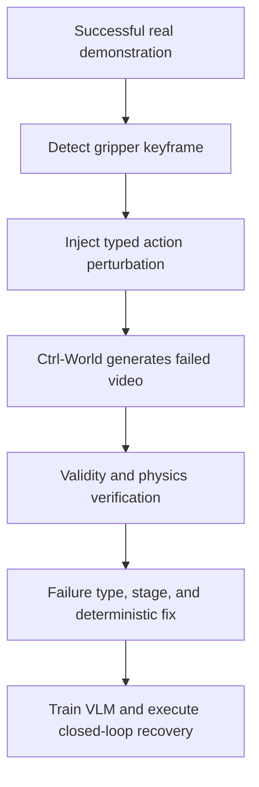

# Counterfactual Failure-Synthesis Pipelines

**Verified:** 2026-07-19
**Focus:** generating failure video and correction supervision from successful robot demonstrations.

Failure synthesis is becoming a distinct data-scaling strategy for robot reward and recovery models. The strongest version does more than relabel or truncate a successful trajectory: it chooses a causal intervention, generates the resulting failed rollout, verifies that the failure is visually and physically plausible, and retains the known inverse intervention as a correction target.

## Dream2Fix pipeline

[Dream2Fix](https://arxiv.org/html/2603.13528v1) starts from successful real-world demonstrations and uses the action-conditioned [Ctrl-World](https://arxiv.org/abs/2510.10125) generative world model to synthesize photorealistic counterfactual failures.



| Component | Dream2Fix design |
|---|---|
| Source | Successful real-world video with recorded state/action sequence |
| Intervention location | A local temporal window around the gripper open/close keyframe |
| Failure types | `delay_close`, `weak_close`, `force_open`, `translation` |
| Video generator | Ctrl-World, conditioned on the perturbed robot actions rather than only task text |
| Generated supervision | Success/failure result, failure type, failure stage, structured correction fields, and optional language summary |
| Correction origin | Deterministically inverted from the injected perturbation parameters, rather than freely hallucinated by an LLM |
| Verification | Intended-failure validity, visual/temporal coherence, inverse-dynamics consistency, point-tracking consistency, and joint-limit/velocity/acceleration safety |
| Reported scale | More than 120K paired failure–correction samples |
| Learned model | Qwen3-VL-8B-Instruct adapted to output result, type, stage, and executable correction |
| Real evaluation | Franka Research 3 + Franka Hand + fixed Intel RealSense D435i; 100 real trajectories across 10 tasks for the real-failure test set |
| Release state | Paper and project page public; project page still says code coming soon, and a reusable dataset/checkpoint release was not verified on 2026-07-19 |

The four interventions cover controllable gripper timing/strength and end-effector translation. They do not yet cover the full real-failure distribution: collisions with unseen objects, deformable-object topology, tool misuse, force-control instability, multi-arm coordination, semantic planning errors, and long-horizon compounding failures remain open.

## How it differs from nearby synthesis strategies

| Strategy | Representative work | What is perturbed? | Does a failed motion get generated/executed? | Best supervision | Main limitation |
|---|---|---|---|---|---|
| Temporal or semantic pseudo-negative | Robo-Dopamine; RoboReward; Guardian BridgeDataV2-Fail | Frame order, instruction, image pair, or endpoint | No | Relative progress or verifier classification | Negative may not exhibit failure dynamics |
| Simulator intervention | [DenseReward](https://arxiv.org/html/2607.13033v1), FAILSafe, RACER | Grasp detector, motion planner, action, or simulator state | Yes, in simulation | Dense reward, failure onset/type, recovery | Sim-to-real appearance and dynamics gap |
| Action-conditioned world-model intervention | Dream2Fix | Recorded robot action near an event keyframe | A video rollout is generated, not physically executed | Paired diagnosis and deterministic trajectory correction | Generator bias and physical-consistency risk |
| Real policy/teleoperation failure | RoboArena, REASSEMBLE, ViFailback | The real policy, operator, object, or environment naturally deviates | Yes, on hardware | Outcome, preference, true failure/recovery | Expensive, risky, imbalanced, and harder to label |

DenseReward and Dream2Fix are especially complementary. DenseReward generates simulated physical trajectories with phase-aware frame-level rewards; Dream2Fix preserves real visual context through a video world model and provides paired correction targets. A useful future corpus would combine Dream2Fix-style photorealistic counterfactuals, DenseReward-style dense reward curves, and a smaller anchor set of genuine real failures.

## Why this is a likely growth direction

1. **Failure coverage can be designed.** Instead of waiting for rare errors, a curator can cross task stage, object, embodiment, and perturbation severity.
2. **The correction comes almost for free.** If the failed rollout is produced by a known action intervention, the inverse intervention supplies paired recovery supervision.
3. **Real successes are reusable.** Large success-heavy datasets can support counterfactual failure generation without repeatedly risking hardware.
4. **World models can close the loop.** Policy failures can update the generator; the generator proposes new failures; reward/recovery models filter them; verified real rollouts recalibrate the system.
5. **It supports more than binary reward.** The same pair can supervise outcome, failure onset, typed diagnosis, severity, preference, recovery value, and executable correction.

## Required safeguards

- Keep `world_model_synth` distinct from `real_executed` even when the source video is real.
- Store the source episode, generator/version, perturbation type and parameters, keyframe, random seed, and all verifier scores.
- Retain generated successes and rejected failures to measure selection bias; do not publish only verifier-approved examples.
- Use held-out **real executed failures** as the primary external test set. Generated-on-generated accuracy is insufficient.
- Measure failure validity, visual artifacts, action–video consistency, reward calibration, recovery execution success, and false alarms on nominal success independently.
- Split by task, object, environment, source episode, and generator version to prevent paired-reference leakage.
- Test failure modes outside the synthesis taxonomy; a model trained on four predefined errors may simply classify the generator's signatures.

## Proposed registry fields

```yaml
failure_provenance: world_model_synth
source_episode_id: ...
source_reality: real_success
generator: Ctrl-World
generator_revision: ...
intervention:
  stage: pre_grasp
  type: translation
  parameters: ...
verification:
  intended_failure: pass
  visual_quality: ...
  dynamics_consistency: ...
  point_tracking: ...
  kinematic_safety: pass
labels:
  outcome: failure
  failure_type: translation
  correction: ...
real_execution_verified: false
```

The final Boolean is essential: a counterfactual may be visually convincing and still never have occurred on hardware.

## Primary sources

- [Dream2Fix paper](https://arxiv.org/html/2603.13528v1) and [project page](https://dream2fix.github.io/)
- [DenseReward paper](https://arxiv.org/html/2607.13033v1)
- [Guardian / FailCoT paper](https://arxiv.org/html/2512.01946v3)
